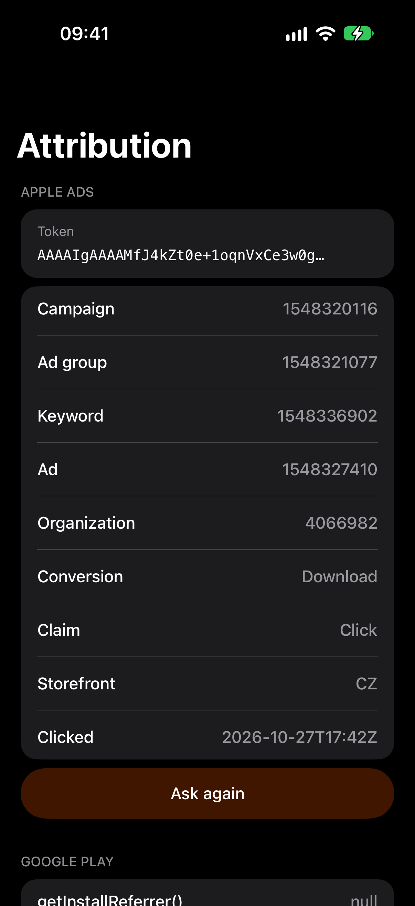
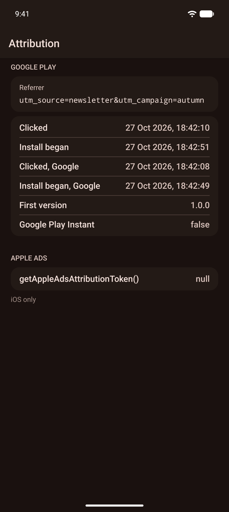

# expo-install-attribution

[](https://www.npmjs.com/package/@hzblj/expo-install-attribution)
[](./LICENSE)

Where an install came from, for Expo: the Play Install Referrer on Android and Apple Ads attribution through AdServices on iOS, as promises with coded errors.

<p>
  
  
</p>

```sh
npx expo install @hzblj/expo-install-attribution
```

```ts
import {getAppleAdsAttribution, getInstallReferrer} from '@hzblj/expo-install-attribution'

const referrer = await getInstallReferrer() // Android: utm_source=newsletter&utm_campaign=autumn
const campaign = await getAppleAdsAttribution() // iOS: the Apple Ads campaign, or null
```

**[Documentation](./packages/expo-install-attribution/README.md)**: the API, the fields, every error code and what isn't supported.

## This repository

| Path | What lives there |
| --- | --- |
| `packages/expo-install-attribution/` | `@hzblj/expo-install-attribution`, the published package: the JavaScript API and the iOS and Android module |
| `apps/example/` | The example app: what both stores answer for this install |

```sh
yarn                 # install
yarn prebuild        # a clean `expo prebuild` of the example
yarn ios             # run the example on iOS (dev client); `yarn android` for Android
yarn start           # Metro for the example
yarn lint            # Biome and TypeScript
yarn test            # the Apple Ads client and the error guards
yarn pack:check      # pack the package as npm gets it and type-check a consumer
yarn changeset       # describe a change for the next release
```

## More libraries

The other libraries from the same author are at **[libraries.janblazej.dev](https://www.libraries.janblazej.dev)**.

## Sponsorship

<a href="https://www.buymeacoffee.com/hzblj"></a>

## License

MIT © Jan Blazej
